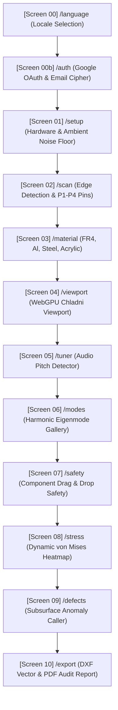

# HARMONIX-AR 🔬🔊
### Next-Generation Augmented Reality Chladni Resonance & Nondestructive Testing Platform
Built with **Next.js 15+ (App Router)**, **TypeScript**, **Tailwind CSS**, and **Supabase (PostgreSQL)**.

---

## 🎨 Extracted Visual Design System Tokens

Extracted directly from the Figma SVGs exported into `public/assets/`:

| Token | Hex Value | Semantic Usage |
| :--- | :--- | :--- |
| **Canvas Dark Background** | `#0D191C` | Primary screen dark background |
| **Surface Deep Card** | `#101F23` | Recessed meters, inputs & inner frames |
| **Card Standard Surface** | `#15282C` | Default Chamfered Card surfaces |
| **Card Active Surface** | `#1C332E` | Highlighted/active card surfaces |
| **Interactive Item Surface** | `#233A3D` | Small badges, sub-cards & buttons |
| **Stroke & Border** | `#294044` | Default 1px & 1.5px structural borders |
| **Stroke Active / Hover** | `#3E5556` | Elevated border stroke |
| **Primary Accent CTA** | `#0EB29A` | Teal cyber glow for active CTA & nodal lines |
| **Secondary Accent** | `#DDF0C2` | Lime yellow-green frequency & resonance tags |
| **Muted HUD Labels** | `#8C999A` | Monospaced readouts, telemetry labels & icons |
| **Crisp Light Text** | `#F5FDFF` | White header & numeric readouts |
| **Alert / Danger** | `#FF4444` | Defect anomalies & high-shear antinodes (`#2D0A0A` bg) |
| **Safe / Conformance** | `#4ADE80` | Low-stress nodal lines & pass status (`#0D2B1A` bg) |
| **Warning / Resonance** | `#F5C518` | Hardware check in-progress & sweep states |

---

## 🧭 12-Screen Navigation Flow



---

## 🗄️ Supabase PostgreSQL Setup

1. Configure your environment variables in `.env.local`:
   ```bash
   NEXT_PUBLIC_SUPABASE_URL=https://your-project.supabase.co
   NEXT_PUBLIC_SUPABASE_ANON_KEY=your-anon-key-here
   ```
2. Execute the migration script located in [`supabase/migrations/20261103000000_init_schema.sql`](file:///c:/Users/Nandheesaprasad/Harmonix-AI/supabase/migrations/20261103000000_init_schema.sql) in your Supabase SQL editor:
   - Creates `public.profiles` with `handle_new_user` trigger on `auth.users`
   - Creates `public.workpiece_scans` with RLS
   - Creates `public.inspection_sessions` with RLS

---

## ⚙️ Physics & Arena Math Hooks (`src/hooks/`)

- [`useAudioPitch.ts`](file:///c:/Users/Nandheesaprasad/Harmonix-AI/src/hooks/useAudioPitch.ts): Autocorrelation algorithm connecting microphone audio stream to pitch detection, note quantization (`F#5`, `A4`), and resonance lock.
- [`useBoundaryDetection.ts`](file:///c:/Users/Nandheesaprasad/Harmonix-AI/src/hooks/useBoundaryDetection.ts): Optical video frame processor tracking 4 draggable boundary corner pins (P1–P4), computing aspect ratio and plate surface area in mm².
- [`useChladniShader.ts`](file:///c:/Users/Nandheesaprasad/Harmonix-AI/src/hooks/useChladniShader.ts): WebGPU compute & render pipeline running WGSL shader for 32,768 particles dynamically driven by frequency and $(m, n)$ nodal mode equations.

