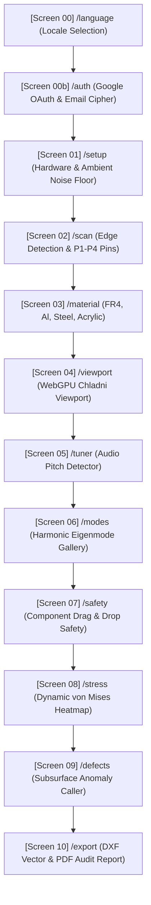

# HARMONIX-AR 🔬🔊
### Next-Generation Augmented Reality Chladni Resonance & Nondestructive Testing Platform
Built with **Next.js 15+ (App Router)**, **TypeScript**, **Tailwind CSS**, and **Supabase (PostgreSQL)**.

---

## 🎨 Extracted Visual Design System Tokens

Extracted directly from the Figma SVGs exported into `public/assets/`:

| Token | Hex Value | Semantic Usage |
| :--- | :--- | :--- |
| **Canvas Dark Background** | `#0D191C` | Primary screen dark background |
| **Surface Deep Card** | `#101F23` | Recessed meters, inputs & inner frames |
| **Card Standard Surface** | `#15282C` | Default Chamfered Card surfaces |
| **Card Active Surface** | `#1C332E` | Highlighted/active card surfaces |
| **Interactive Item Surface** | `#233A3D` | Small badges, sub-cards & buttons |
| **Stroke & Border** | `#294044` | Default 1px & 1.5px structural borders |
| **Stroke Active / Hover** | `#3E5556` | Elevated border stroke |
| **Primary Accent CTA** | `#0EB29A` | Teal cyber glow for active CTA & nodal lines |
| **Secondary Accent** | `#DDF0C2` | Lime yellow-green frequency & resonance tags |
| **Muted HUD Labels** | `#8C999A` | Monospaced readouts, telemetry labels & icons |
| **Crisp Light Text** | `#F5FDFF` | White header & numeric readouts |
| **Alert / Danger** | `#FF4444` | Defect anomalies & high-shear antinodes (`#2D0A0A` bg) |
| **Safe / Conformance** | `#4ADE80` | Low-stress nodal lines & pass status (`#0D2B1A` bg) |
| **Warning / Resonance** | `#F5C518` | Hardware check in-progress & sweep states |

---

## 🧭 12-Screen Navigation Flow



---

## 🗄️ Supabase PostgreSQL Setup

1. Configure your environment variables in `.env.local`:
   ```bash
   NEXT_PUBLIC_SUPABASE_URL=https://your-project.supabase.co
   NEXT_PUBLIC_SUPABASE_ANON_KEY=your-anon-key-here
   ```
2. Execute the migration script located in [`supabase/migrations/20261103000000_init_schema.sql`](file:///c:/Users/Nandheesaprasad/Harmonix-AI/supabase/migrations/20261103000000_init_schema.sql) in your Supabase SQL editor:
   - Creates `public.profiles` with `handle_new_user` trigger on `auth.users`
   - Creates `public.workpiece_scans` with RLS
   - Creates `public.inspection_sessions` with RLS

---

## ⚙️ Physics & Arena Math Hooks (`src/hooks/`)

- [`useAudioPitch.ts`](file:///c:/Users/Nandheesaprasad/Harmonix-AI/src/hooks/useAudioPitch.ts): Autocorrelation algorithm connecting microphone audio stream to pitch detection, note quantization (`F#5`, `A4`), and resonance lock.
- [`useBoundaryDetection.ts`](file:///c:/Users/Nandheesaprasad/Harmonix-AI/src/hooks/useBoundaryDetection.ts): Optical video frame processor tracking 4 draggable boundary corner pins (P1–P4), computing aspect ratio and plate surface area in mm².
- [`useChladniShader.ts`](file:///c:/Users/Nandheesaprasad/Harmonix-AI/src/hooks/useChladniShader.ts): WebGPU compute & render pipeline running WGSL shader for 32,768 particles dynamically driven by frequency and $(m, n)$ nodal mode equations.


## Harmonix interactive 3D film

The home page opens the guided, 88-second interactive workshop film directly (also available at `/film`). The existing app routes remain in the repository and can be opened directly. It opens on an idealized response, then moves back to preparation before returning to the test and its interpretation. Drag to orbit, scroll to zoom, click a glowing marker in exploration mode or choose a chapter; use the left and right arrow keys for the previous and next chapter, and resume the film with the play button. The technician, equipment and workshop are stylized staging. The inspector holds an in-scene phone with both hands and sweeps it over the workpiece. The automatically advancing workflow is dramatized, not a live AI run. The phone displays static captures of the real app screens, recorded with example settings. These captures are not interactive, do not use live sensors, and the scan shows the app’s sample PCB rather than the illustrated aluminium plate. No inspection outcome is verified.

The **Record video** button uses browser tab sharing: select the current tab, keep it visible, then download the resulting silent WebM or MP4. The browser controls the captured resolution and may capture anything visible in the chosen tab. Recording requires browser support for `getDisplayMedia` and `MediaRecorder`.

The plate graphic is a deliberately simplified analytical illustration, not a sensor reading. It uses the Kirchhoff–Love thin-plate solution for a simply supported, homogeneous isotropic aluminium rectangle (240 × 180 × 1.6 mm, E = 68.9 GPa, density = 2700 kg/m³, Poisson ratio = 0.33). Mode shapes are `sin(mπx/a) sin(nπy/b)` and the displayed frequencies follow the corresponding ideal eigenfrequency equation. Motion is slowed and displacement exaggerated for visibility. It does not model chemistry, granular dynamics, damping, real supports, defects or AR tracking, and must not be used for inspection decisions. The 3D scene limits rendering to 30 fps and caps pixel ratio for modest hardware; WebGL is required and 4K output or a particular frame rate cannot be guaranteed.

Run the analytical plate checks with `node --experimental-strip-types --test tests/film-physics.test.mjs` on Node 22.

A self-contained version is available at `docs/harmonix-film.html` (regenerate it with `npm run build:film-html`). Open the downloaded file in a WebGL-enabled browser; tab recording also requires browser support and a secure context. The embedded app screens are static examples, not live AI or sensor data. Model notes remain available on demand instead of covering the film.
